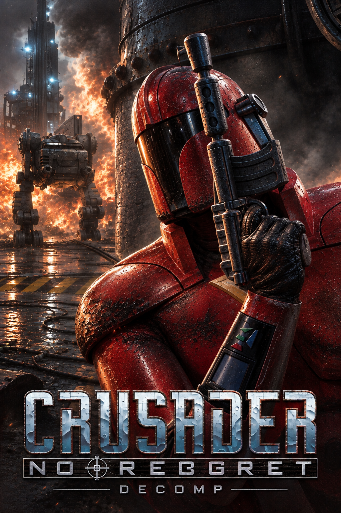
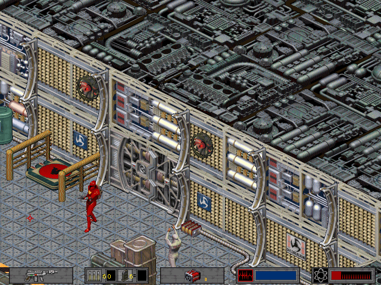

# Crusader: No Regret — DECOMP



A C++20/SDL2 reimplementation of the *Crusader: No Regret* (Origin, 1996) engine for Windows and Linux. The project is an **early work in progress: the game is not fully playable yet** (see [Status](#status)).



This repository contains **no game files**: you need your own copy of the original game. The following version is currently supported:

- The **English version 1.06** (CD) — ISO SHA-256: `8EBA7BB0956D539AA841E5D483A6F39222DD6615BA78478544FA516FD7467EBF`

## How this port is made

*No Regret* runs on the engine of *Crusader: No Remorse*, and this project starts from the [No Remorse port](https://github.com/sebsebseb1982/crusader-no-remorse-decomp). A plain copy would miss everything No Regret changed, so the original executable drives the work:

1. Every routine of `REGRET.EXE` was compared with the routine of the No Remorse `CRUSADER.EXE` (French 1.08) the port was written from. Of 2 982 routines, 2 320 are identical, 219 differ by constants only, 228 are modified and 215 are new; 210 No Remorse routines are gone.
2. Every function of the port names the original routine it rewrites (`// @orig <segment:offset>`, an address in `REGRET.EXE`). A function whose routine is not identical in No Regret carries a `TODO(regret)` line until it has been read against `REGRET.EXE` and corrected.
3. The code inherited from No Remorse is kept as is only where the routine is proven identical.
4. The data formats are checked by end-to-end tests on the real No Regret files.

[docs/REGRET_DIFF.md](docs/REGRET_DIFF.md) lists what changed, module by module and intrinsic by intrinsic, and the work left.

## Status

| Area | State |
|---|---|
| Game data recognised (`REGRET.EXE`, 1.06) | done |
| Usecode: the 350 intrinsics numbered; 336 share a routine with No Remorse | done |
| Intrinsics that exist only in No Regret | 14 of 14 bound |
| NPC records (45 equipment slots), weapon, item and fire type tables of `REGRET.EXE` | done |
| New game: start-up movies, first map loaded and drawn, scripts running without fault | done |
| NPC attacks, damage, projectiles, animations, gravity, explosions, mission changes | done |
| Controls: keyboard moves, function keys, typed codes, inventory keys | done |
| Status bar and weapon overlays | done |
| Movies (Xan codec of `XANDRV32.DLL`, rewritten), with sound and subtitles, 8-bit and 16-bit colour | done |
| Music: track list, map music, Christmas track | done |
| Menus and screens | started: main menu, difficulty, load and save done; options and help left |
| Saved games in the No Regret layout | done, not yet compared with saves made by the original |
| Sound driver (`ASYLUM.DLL` is another build) | to check |
| Functions to review against `REGRET.EXE` (`TODO(regret)` lines) | 76 left |

## Inherited from the No Remorse port

Everything the No Remorse port adds is in the code and is brought back as the game becomes playable; [enhancements.md](enhancements.md) describes these features as written for No Remorse:

- Gamepad support with vibration (in No Regret's play, the pad's menu button opens the menu, as F1 does).
- An **Enhancements** menu: gamepad remapping, a camera that follows the player, directional movement and aiming with the sticks, native resolution, zoom, autosave.
- Fullscreen toggle with **Alt+Enter**.
- The level editor (`crusader-editor`), built but not yet adapted to No Regret's maps.

## Planned improvements

- Review the remaining `TODO(regret)` functions against `REGRET.EXE`.
- Finish the No Regret menus and screens (options, help).
- Compare the port with the original under DOSBox: movies, status bar, saved games.
- Check each enhancement inherited from No Remorse on No Regret.
- Have an idea? Let me know what you'd like to see!

Further improvements will come when my Claude subscription renews. If you'd like to help speed things up, feel free to leave a small tip (see [SPONSORING.md](SPONSORING.md)).

## Running the game

### 1. Get the game

Download the archive for your system (Windows, Linux or PortMaster) from the [latest release](https://github.com/sebsebseb1982/crusader-no-regret-decomp/releases/latest), or build the game from source (see [Building from source](#building-from-source)).

### 2. Provide the game data

Copy the **entire contents** of the No Regret CD (English 1.06) into `data/`:

```
crusader(.exe)
data/
├── REGRET.EXE          the original executable (identifies the version; its tables are read)
├── CRUSADER.CFG        settings
├── STATIC/             shapes, palettes, fonts, maps, tables  (SHAPES.FLX, FIXED.DAT, GLOB.FLX, TYPEFLAG.DAT, ANIM.DAT, GUMPS.FLX, FONTS.FLX, *.PAL, *.BMP, …)
├── USECODE/            game scripts  (EUSECODE.FLX, UNKCOFF.DAT, UNKDS.DAT)
├── SOUND/              sound effects and music  (SOUND.FLX, M01.AMF …, CRED.AMF)
├── FLICS/              cutscenes  (*.AVI with the Xan codec, and their subtitles *.IFF)
└── SAVEGAME/           saved games (optional for a new game)
```

`XANDRV32.DLL` and `ASYLUM.DLL` are not needed: the port rewrites the movie decoder and the sound driver. Installing from the CD image (`.iso`), as the No Remorse port does, is not checked on No Regret yet.

### 3. Launch

```sh
./crusader data                   # the start-up movies, then the menu   (Windows: crusader.exe data)
./crusader data --new-game        # starts a new game at once
./crusader data --save 1          # resumes SAVEGAME.1 from the data folder
./crusader data --movie 01A       # plays one movie
./crusader --version
```

## Building from source

Requirements: CMake 3.21 or later and a C++20 compiler (Visual Studio 2022, GCC 11+, or Clang 14+).

```sh
cmake -S . -B build -DCMAKE_BUILD_TYPE=Release     # Windows: -G "Visual Studio 17 2022" -A x64
cmake --build build --config Release
ctest --test-dir build -C Release --output-on-failure
```

If SDL2 is installed on your system, the build uses it (`libsdl2-dev` on Linux). Otherwise, SDL2 is downloaded and built automatically.

The executable is `build/Release/crusader` on Windows and `build/crusader` on Linux.

The tests come in three groups:

- `tests/`: no game data needed.
- `e2e/regret_data_tests`: the No Regret data (`-DCRUSADER_DATA_DIR=…`; defaults to `data/`), registered only when it is found.
- The other `e2e/` tests come from the No Remorse port and need the No Remorse data (French 1.08) and saved games: `-DCRUSADER_REMORSE_DATA_DIR=…` (defaults to `data_remorse/`) and `-DCRUSADER_TEST_SAVES_DIR=…`. They are registered as `remorse_*` and guard the code both games share.

In addition to `crusader`, the build produces several tools: `shapeview` (shape viewer), `mapview` (map viewer), `ucsmoke` and `useprobe` (script execution), `diffcheck` (comparison with the original), and the level editor `crusader-editor`.

## Versioning

Versions follow [SemVer](https://semver.org) and are calculated automatically from [Conventional Commits](https://www.conventionalcommits.org): `fix:` increments the patch version, `feat:` increments the minor version, and `BREAKING CHANGE` increments the major version. A release is published on every push to `main` that contains a `fix:` or `feat:` commit. See [`docs/RELEASING.md`](docs/RELEASING.md) for details.

## Contribution

Contributions are welcome; see [CONTRIBUTING.md](CONTRIBUTING.md) for the full guide. For substantial changes, please open an issue first to discuss the proposed approach. When reporting a bug, include the operating system, a screenshot, a savegame, the steps to reproduce it, and any relevant error messages or logs.

Pull requests should describe the change and its purpose, stay focused, and include tests where appropriate. A change to a function marked `TODO(regret)` should come from reading its routine in `REGRET.EXE`, and remove the line only once that is done. Before submitting one, build the project and run the available tests:

```sh
cmake --build build --config Release
ctest --test-dir build -C Release --output-on-failure
```

Tests that require the original game data will run only when the data is available and configured as described above.

## License and rights

The port's code and documentation are released under the [GNU GPL v3](LICENSE) or, at your option, any later version. You may use, study, modify, and redistribute them, provided that every redistributed version, modified or not, remains under the same license and includes its source code.

This license applies only to this repository. *Crusader: No Regret* remains the property of its rights holders. This project does not distribute the game's code or data. You must own a copy of the game to play it.
